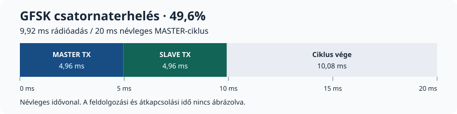

# Kommunikációs specifikáció

A táblázatok a firmware jelenlegi értékeit rögzítik. Ha átírsz egy értéket, kérd a Codextől: „Vezesd át a docs/kommunikacio.md módosításait a firmware-be, és ellenőrizd a buildet.” Az [AGENTS.md](../AGENTS.md) rögzíti ezt a munkamenetet.

## MASTER–SLAVE rádiós kapcsolat

| Paraméter | Érték | Implementáció |
| --- | --- | --- |
| Moduláció | GFSK | [radio_link.c](../main/radio_link.c), [sx1262.c](../components/SX1262/sx1262.c) |
| Frekvencia | 869 525 000 Hz | `CONFIG_LINK_FREQUENCY_HZ` |
| Adóteljesítmény | 14 dBm | `CONFIG_LINK_TX_POWER_DBM` |
| Bitsebesség és frekvencialöket | 100 000 bit/s, ±25 000 Hz | `sx1262_default_gfsk_config` |
| Szűrés és RX sávszélesség | Gauss BT 0,5, 187,2 kHz | `configure_gfsk` |
| Preambulum és detektor | 32 bit, 16 bites detektor | `sx1262_default_gfsk_config`, `packet_params` |
| Szinkronszó | 32 bit, `2D D4 B7 E1` | `sx1262_default_gfsk_config` |
| Cím szerinti szűrés | Kikapcsolva | `packet_params` |
| CRC | CRC-16/CCITT-FALSE, kezdőérték 0xFFFF, polinom 0x1021 | `configure_gfsk` |
| Whitening | Bekapcsolva, seed 0x1FF | `sx1262_default_gfsk_config`, `packet_params` |
| Csomaghossz | Változó hosszúság, driverlimit 64 bájt, alkalmazáskeret 51 bájt | `SX1262_GFSK_DEFAULT_MAX_PAYLOAD_LENGTH`, `FRAME_LENGTH` |

A keret első 50 bájtja a MASTER véletlen adata vagy a SLAVE bitenként negált válasza. Az utolsó bájt a 8 bites sequence mező. A MASTER 0-ról indul, kérésenként kettővel lép, és 254 után 0-ra fordul. A SLAVE a kérés értékéhez egyet ad. A MASTER ezt a páratlan értéket ellenőrzi a válaszban.

A kijelzőn a MISS minden UP állapotban elutasított keretnél eggyel nő. Ilyen a CRC- vagy fejléc-hiba, a helytelen kerethossz, a hibás sequence és a MASTER által észlelt adathiba. A vételi időkorlát és a sequence értékek közötti kihagyás nem növeli a MISS-t. A DROPS az UP állapotból vételi elévülés miatt bekövetkező DOWN átmeneteket számolja. A DOWN MISS csak DOWN állapotban gyűlik és látható. A MASTER minden DOWN állapotban indított, érvényes válasz nélkül lezárult kérés után egyet számol. A SLAVE a névleges 20 ms-os ciklus alapján becsüli a DOWN alatt érvényes kérés nélkül eltelt ciklusok számát. Induláskor a kapcsolat DOWN állapotú. A számlálók az újraindításig gyűlnek, az üzemmódváltás megőrzi őket.

| Időzítés | Érték | Konstans a radio_link.c fájlban |
| --- | --- | --- |
| MASTER-ciklus | 20 ms | `CYCLE_MS` |
| Vételi ablak | 22 ms, a ciklus 110%-a felfelé kerekítve | `RX_WINDOW_MS` |
| Kapcsolat elévülése | 60 ms, három ciklus | `LINK_EXPIRY_MS` |
| Vételi lekérdezés időkorlátja | 2 ms | `RX_SLICE_MS` |
| Adás időkorlátja | 12 ms | `TX_TIMEOUT_MS` |
| SLAVE válaszküldés | Közvetlenül a válaszkeret előállítása után | `slave_receive` |
| RSSI átlagolási ablak | 1 000 ms | `RSSI_AVERAGE_MS` |

## Rádiós csatornaterhelés

Sikeres kérés–válasz esetén a névleges rádiós csatornaterhelés **49,6%**. Egy változó hosszúságú GFSK csomag 4 bájt preambulumból, 4 bájt szinkronszóból, 1 bájt hosszmezőből, 51 bájt alkalmazáskeretből és 2 bájt CRC-ből áll. A 62 bájt (496 bit) adásideje 100 kbit/s sebességen 4,96 ms. A MASTER és a SLAVE együtt 9,92 ms-ot ad egy névleg 20 ms-os ciklusban. [Semtech SX1261/2 adatlap, 6.2.1.2](https://s.heltec.cn/download/HT-N5262M/Semtech-SX1262_datasheet.pdf)

A SLAVE a fogadott keret feldolgozása és a válaszkeret előállítása után azonnal elindítja az adást. A grafikon csak a névleges adásidőkkel számol. A tényleges válaszkezdetet a feldolgozás és a rádió átkapcsolása határozza meg. Válasz hiányában a vételi időkorlát miatt a MASTER-ciklus 20 ms fölé nyúlhat.

## M_FHSS–S_FHSS rádiós kapcsolat

A rövid gombnyomás sorrendje MASTER → SLAVE → M_FHSS → S_FHSS → GFSK → LORA → MASTER. Az új módok ugyanazt a kapcsolati képernyőt és számlálókat használják. Az FHSS két végpontján azonos firmware szükséges.

| Paraméter | Érték |
| --- | --- |
| Moduláció | A fix frekvenciás GFSK paraméterei, eltérő szinkronszóval: `2D D4 B7 4A` |
| Adatcsatornák | 868,100 · 868,300 · 868,500 MHz |
| Találkozócsatorna | 869,525 MHz, minden negyedik időrésben, azaz 80 ms-onként |
| Időrés | 20 ms, fix MASTER időalap |
| Válaszablak | A MASTER az időrés 17. ms-áig indít vételi lekérdezést, a válasz ugyanazon a frekvencián megy |
| Kapcsolat elévülése | 60 ms, három időrés |
| Szinkron megtartása érvényes vétel nélkül | 120 ms |
| Adóteljesítmény | `CONFIG_LINK_TX_POWER_DBM`, az aktuális buildben 14 dBm |

A 49 bájtos alkalmazáskeret sorrendje: 40 bájt adat, 1 bájt sequence, 4 bájt munkamenet-azonosító és 4 bájt időrésszám. A két 32 bites mező little-endian. A MASTER véletlen adatot küld és kérésenként kettővel növeli a sequence értéket. A SLAVE a 40 adatbájtot negálja, a sequence értékéhez egyet ad, és változatlanul visszaküldi a munkamenet-azonosítót és az időrésszámot. A MASTER mind a négy mezőt ellenőrzi. A keret 15 bájttal a driver 64 bájtos határa alatt marad.

A MASTER új munkamenetet indít az M_FHSS módba lépéskor. Minden négyes csoport első időrése a találkozócsatornát használja, a következő három időrés egyszer-egyszer érinti mindhárom adatcsatornát. A sorrend a munkamenet-azonosítóból és a csoport sorszámából adódik. A találkozócsatornán is teljes kérés–válasz történik, így az első sikeres csere egyszerre szinkronizál és állítja helyre a linket.

Rövid kieséskor a MASTER a saját időalapja szerint ugrik tovább. A SLAVE az utolsó érvényes kérés vételi idejéből számolja a következő időrést, a várt beérkezések között félidőben hangol át, és sikeres vételkor frissíti az időalapját. A SLAVE csak a várt munkamenet és időrés kérésére válaszol. Induláskor vagy 120 ms kiesés után a találkozócsatornán vár, ahol az érvényes kérésből újra felveszi az időalapot. Ha a találkozócsatorna jól vehető, a várakozás kezdetétől névleg legfeljebb 80 ms telik el a következő ilyen kérésig. Tartós zavar ezen a frekvencián megakadályozhatja az újraszinkronizálást.

Az FHSS-keret névleges adásideje 4,80 ms. A három adatcsatorna együtt adónként névleg 18% kitöltést ad a 868,0–868,6 MHz alsávban, a találkozócsatorna külön alsávjában 6%-ot. A számítás folyamatos FHSS üzemre és a csomag névleges adásidejére vonatkozik. A 18% meghaladja az általános célú üzem 1%-os kitöltési lehetőségét ebben az alsávban. A 20 ms-os ütemet árnyékolt vagy vezetékes RF tesztkörnyezetben lehet mérni. [NMHH frekvenciahasználati feltételek](https://stir.nmhh.hu/publicview/open.php?f=rendelet3_hu.html)

## Csatornaszkennelés

| Mód | Frekvenciák (MHz), szkennelési sorrendben |
| --- | --- |
| GFSK | 868,100 · 868,300 · 868,500 · 868,700 · 868,900 · 869,425 · 869,525 · 869,625 |
| LoRa | 867,100 · 867,300 · 867,500 · 867,700 · 867,900 · 868,100 · 868,300 · 868,500 |

A szkennelés csatornánként 6 s, névleg összesen 48 s. A beállási idő 20 ms, az RSSI-mintavétel 50 ms, az aktivitási küszöb −95 dBm (a küszöbértéket elérő minták is aktívnak számítanak). Forrás: [radio_scan.c](../main/radio_scan.c).

A GFSK scan a driver GFSK alapbeállításait használja. A LoRa scan beállításai 125 kHz, SF7, 4/5, 8 preambulumszimbólum, 0x1424 szinkronszó, bekapcsolt CRC, explicit fejléc és normál IQ.

## Soros napló

| Paraméter | Érték | Implementáció |
| --- | --- | --- |
| Elsődleges konzol | UART0, 115 200 baud | `CONFIG_ESP_CONSOLE_UART_BAUDRATE` |
| Másodlagos konzol | USB Serial/JTAG | `CONFIG_ESP_CONSOLE_SECONDARY_USB_SERIAL_JTAG` |
| Teljes rádiókeret hexadecimális naplózása | Kikapcsolva | `CONFIG_LINK_LOG_PAYLOAD` |
| Rádiós naplósor mélysége | 32 bejegyzés | `UART_LOG_QUEUE_DEPTH` |

Az M_FHSS és S_FHSS az első sikeres hangoláskor és minden frekvenciaváltás után Hz-ben naplózza az aktuális frekvenciát (például `S_FHSS freq=869525000 Hz`). A sor akkor is megjelenik, ha az adott frekvencián nem érkezik csomag.

A frekvencia, TX teljesítmény és keretnaplózás konfigurációs opcióit a [Kconfig.projbuild](../main/Kconfig.projbuild) definiálja. A használt build értékeit a `sdkconfig` tartalmazza. A rádiós beállítások módosításakor ellenőrizd a meglévő buildet és az új buildhez használt alapértékeket is.
